  
  

---

### 👨‍💻 About me

- 🎓 Fullstack developer building internal systems for **Urgench State University (UrDU)**
- 🧩 From idea to production: **frontend UI → REST API → database → Docker deployment**
- 🏢 Shipped 100+ projects — university portals, admin dashboards, Telegram bots, CRM & clinic systems
- 🔌 Hardware integrations: **Hikvision face-recognition terminals** controlled via ISAPI from Node.js
- 🌱 Currently improving: system design, DevOps and English (IELTS)
- 💬 Ask me about: Next.js, Express/NestJS, Prisma, PostgreSQL, Yii2

---

### 🛠️ Tech stack

  <b>Frontend</b> 
  
  
  
  
  
  

  <b>Backend</b> 
  
  
  
  
  
   
  
  

  <b>Database & DevOps</b> 
  
  
  
  
  
  
  

---

### 🚀 What I build

| Area | Examples |
|---|---|
| 🎓 **University systems** | HEMIS student login, Moodle integration, quiz & testing platform, KPI system, warehouse (ТМЗ) accounting, staff management |
| 📊 **Admin dashboards** | Role-based dashboards with analytics for managers, departments and employees |
| 🤖 **Telegram bots** | Bots with web apps and backend APIs for notifications, auth and expense tracking |
| 🚕 **Business apps** | Taxi platform, clinic management, online shop, online course platform |
| 🔐 **Integrations** | Hikvision face terminals (ISAPI), access control, user & face upload |

> Most of my work lives in private repositories. Public examples: [taxi_backend](https://github.com/khudayormm/taxi_backend) · [taxi_frontend](https://github.com/khudayormm/taxi_frontend) · [nestjs_backend](https://github.com/khudayormm/nestjs_backend)

---

### 📈 GitHub stats (public + private repositories)

  
  

  

---

💡 *"Make it work, make it right, make it fast."*

